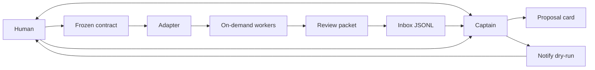

# Architecture

agent-ship-kit is an acceptance-and-attention layer. A captain agent is the
only thing the human talks to. Workers are created when a contract is frozen
and disappear when their slice is done. An orchestrator, if there is one,
sits behind an adapter. The kit stores events, evidence pointers, and a
notification plan. It does not run models, merge to main, or deploy.

## Captain loop



1. Intake stays in the captain thread. The captain writes a proposal card
   (`skills/ship-contract`).
2. The human freezes a contract. Until that happens there is nothing to spawn.
3. The captain dispatches one worker per slice, through the adapter, without
   exceeding `max_parallel` (`skills/ship-dispatch`).
4. The worker returns evidence. The captain writes a review packet and a
   `needs_review` inbox line (`skills/ship-review`).
5. The notify planner matches that event to a policy rule and an allowlist,
   and prints a plan. It does not start the command (`skills/ship-notify`).
6. The human accepts, requests changes, or rejects. Accepting is not a merge.
   The human ships with their own tools.

Workers are not a roster. No slice, no worker. The worker's prompt is the
frozen slice, not the captain transcript.

## Events

`events/schema.json` is the envelope. Every event has:

| Field | Required | Notes |
| --- | --- | --- |
| `id` | yes | `evt_` plus letters, digits, `_`, `-` |
| `type` | yes | See below |
| `title` | yes | One line |
| `summary` | yes | What the human needs to know |
| `created_at` | yes | ISO-8601 |
| `source_task_id` | yes | Adapter task id, or the proposal/contract id before dispatch |

Types:

| `type` | When the captain writes it | Extra required fields |
| --- | --- | --- |
| `proposal_ready` | A draft card is ready for the human | — |
| `contract_frozen` | The human froze a contract | — |
| `worker_dispatched` | Adapter `spawn` returned | — |
| `needs_review` | A packet is waiting | `evidence_urls`, `priority`, `links` |
| `review_decided` | The human decided | `decision`: `accept`, `changes_requested`, or `reject` |
| `notify_planned` | A dry-run was shown | — |

`needs_review` is the attention event. Its fields:

- `evidence_urls` — array of strings. May be empty only as an explicit draft; `priority: high` should not be empty. The CLI warns in that case.
- `priority` — `normal` or `high`.
- `links` — object with optional `pr`, `issue`, and `path`. The object is required; each key is optional.

Optional cross-links on any type: `proposal_id`, `contract_id`, `slice_id`, `worker_ref`, `note`. Unknown keys are rejected by the schema (`additionalProperties: false`).

The inbox CLI writes `needs_review` only. Other types are recorded by the captain in the packet or the contract log in v0; they share the schema so a later log can store them as JSONL too.

An event does not authorize a merge or a deploy. `review_decided` with `accept` records that the evidence matched the contract.

## Storage

```text
.agent-ship/inbox.jsonl
.agent-ship/proposals/<proposal_id>.md
.agent-ship/contracts/<contract_id>.md
.agent-ship/packets/<task_id>.md
```

The inbox is append-only JSONL, one event per line. `cli/src/inbox.ts` creates
the directory, refuses a duplicate `id`, and refuses a priority other than
`normal` or `high`. Runtime files are gitignored. Templates in `templates/`
are the blanks.

Conventions for ids, branch names, and freeze phrases: `templates/e2e-conventions.md`.

## Adapters

```text
spawn(contract_path, slice_id, prompt) -> task_id, worker_ref
status(task_id) -> queued | running | needs_review | failed | cancelled
collect(task_id) -> summary, evidence_urls, links
```

`adapters/generic.md` is normative. `adapters/herdr.md`, `adapters/orca.md`,
and `adapters/multica.md` say what to map those calls onto, without vendoring
those products. v0 does not contain their clients and does not invent their
HTTP paths.

`spawn` fails closed when the contract is not `frozen`. None of the three
calls merge or deploy. The example allowlist pattern `multica *` is a notify
target, not a `spawn` implementation; see `adapters/multica.md`.

With no orchestrator, `spawn` is one new agent session per slice. The human
still speaks only to the captain.

## Notify

v0's decision step is a rule parser, not a model call. The policy markdown
can still carry prose for the captain; the parser reads only `## Rule:` blocks.

A rule:

```markdown
## Rule: high priority page

when.priority: high
when.type: needs_review
action: curl -X POST https://hooks.example/ship
note: Tell the human. Do not merge or deploy.
```

- Conditions that exist today: `when.type`, `when.priority`, `when.source_task_id`. An unknown `when.*` key is an error.
- Every `when.` line must match (string equality on the event). A rule with no conditions is an error.
- The first matching rule wins.
- `action` is one line of whitespace-separated argv. No quoting.

The planner in `cli/src/notify.ts` then classifies that argv. `executed` is
always `false`. There is no execute subcommand.

### Allow and deny reasons

| `reason` | What happened |
| --- | --- |
| `allowlisted` | `allow: true`. A pattern matched the full argv. |
| `not_allowlisted` | A rule matched and the argv is ordinary, but no pattern fits. |
| `no_matching_rule` | No rule's conditions matched. |
| `shell_metacharacter` | The action contains a semicolon, ampersand, pipe, backtick, dollar sign, angle bracket, backslash, carriage return, newline, or NUL. Argv is null. |
| `shell_interpreter` | The program is a shell, `eval`, `busybox`, or `sudo` (basename, case-insensitive, optional path prefix). |
| `empty_action` | The action had no tokens. |

### Allowlist patterns

The file is JSON: `{ "patterns": ["multica *", "curl -X POST https://hooks.example/*"] }`. Extra keys such as `version` are ignored.

Matching rules, implemented by `validatePattern` and `matchPattern`:

- The pattern is split on whitespace.
- The first token is a literal program name matching `[A-Za-z0-9._+/-]+`. It must not contain `*`.
- A token that is exactly `*` matches one argument. If that token is last, it matches one or more remaining arguments. `multica` alone does not match `multica *`. `multica inbox push` does.
- A token ending in a single `*` with a non-empty prefix matches one argument that starts with that prefix. `https://hooks.example/*` matches `https://hooks.example/ship` and does not match `https://hooks.example.evil/ship`.
- The whole argv must be consumed. An extra argument that the pattern did not account for does not match.
- The loader rejects shell metacharacters in a pattern, a leading `*`, more than one `*` in a token, a `*` that is not a suffix, an empty pattern list, and non-string patterns.
- The loader rejects program names whose basename is a shell, `eval`, `busybox`, or `sudo`.
- The loader rejects a wildcard pattern whose program is `node`, `nodejs`, `deno`, `bun`, `python`, `python3`, `perl`, `ruby`, or `php`.

Denied plans are still successful dry-runs: the process exits 0 and the JSON says `allow: false`. Missing files, a broken policy, or a broken allowlist exit 1.

Environment variables are not expanded, so a secret cannot be pulled into the plan by writing `$TOKEN`. The `$` is rejected first.

## Invariants

1. The human has one captain conversation from intake through ship.
2. Workers are spawned per frozen contract slice. No standing roster is required.
3. The human freezes contracts, reviews packets, and is the one who merges or ships.
4. Notify never starts a shell. v0 never starts the allowlisted program either.
5. No secrets in the repo, the cards, the events, or the policy files.
6. Adapters are replaceable. The event and the contract card are not.

## What v0 leaves out

- A real `notify run` that would `spawn` an allowlisted argv with `shell: false`.
- Executable Herdr, Orca, or Multica bindings.
- A model call inside the notify decision step. The markdown is ready for a later captain to read; the CLI does not need one.
- Hosting model runtimes, multi-agent scheduling, auto-merge, and production deploy.
