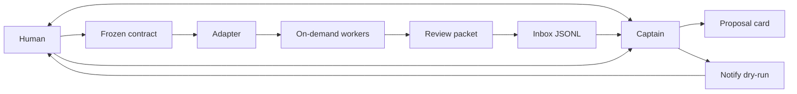

# Architecture

agent-ship-kit is an acceptance-and-attention layer. A captain agent is the
only thing the human talks to. Workers are created when a contract is frozen
and disappear when their slice is done. An orchestrator, if there is one,
sits behind an adapter. The kit stores events, evidence pointers, and a
notification plan. It does not run models, merge to main, or deploy.

## Captain loop



1. Intake stays in the captain thread. The captain writes a proposal card
   (`skills/ship-contract`).
2. The human freezes a contract. Until that happens there is nothing to spawn.
3. The captain dispatches one worker per slice, through the adapter, without
   exceeding the contract's `max_parallel` or the global cap of 3
   (`skills/ship-dispatch`, `templates/workflow.md`).
4. If the worker is blocked or needs a mid-task decision, it returns that to
   the captain. The captain files `blocked` or `needs_approval`. The human
   does not open the worker session.
5. The worker returns evidence. The captain writes a review packet, including
   E2E rows when smoke ran, and a `needs_review` inbox line (`skills/ship-review`,
   `skills/ship-e2e`).
6. Normal inbox items are pull. The notify planner pushes only for a
   high-priority review that has evidence, or for `blocked` / `needs_approval`.
   `notify dry-run` prints the plan. `notify run` may start that argv with no
   shell (`skills/ship-notify`).
7. The human accepts, requests changes, or rejects with `inbox decide`.
   Accepting is not a merge. The human ships with their own tools.

Workers are not a roster. No slice, no worker. The worker's prompt is the
frozen slice, not the captain transcript.

## Events

`events/schema.json` is the envelope. Every event has:

| Field | Required | Notes |
| --- | --- | --- |
| `id` | yes | `evt_` plus letters, digits, `_`, `-` |
| `type` | yes | See below |
| `title` | yes | One line |
| `summary` | yes | What the human needs to know |
| `created_at` | yes | ISO-8601 |
| `source_task_id` | yes | Adapter task id, or the proposal/contract id before dispatch |

Types:

| `type` | When the captain writes it | Extra required fields |
| --- | --- | --- |
| `proposal_ready` | A draft card is ready for the human | — |
| `contract_frozen` | The human froze a contract | — |
| `worker_dispatched` | Adapter `spawn` returned | — |
| `needs_review` | A packet is waiting | `evidence_urls`, `priority`, `links` |
| `blocked` | The worker cannot continue | `priority` |
| `needs_approval` | The worker needs a mid-task decision | `priority` |
| `review_decided` | The human decided, closing one inbox item | `decision`, `subject_id` |
| `notify_planned` | A plan was shown | — |

`needs_review`, `blocked`, and `needs_approval` are attention events. The inbox
stores them. `inbox list` shows the ones that do not yet have a
`review_decided` row whose `subject_id` is that item. `inbox list --all`
shows the log, including decisions.

`needs_review` fields:

- `evidence_urls` — array of strings. May be empty only as an explicit draft. `priority: high` with an empty array is not paged. The CLI warns on add and the planner sets `missing_evidence` (or matches no push rule).
- `priority` — `normal` or `high`. Normal items are pull: no push rule in the example policy.
- `links` — object with optional `pr`, `issue`, and `path`. The object is required; each key is optional.

`blocked` and `needs_approval` carry `priority` and the same envelope. They may
push without evidence URLs, because the owner is stuck and does not open the
worker session.

Optional cross-links on any type: `proposal_id`, `contract_id`, `slice_id`, `worker_ref`, `note`. Unknown keys are rejected by the schema (`additionalProperties: false`).

`inbox add --type` writes the three attention types. `inbox decide <id> accept|changes_requested|reject` appends `review_decided`. An event does not authorize a merge or a deploy. `accept` records that the evidence matched the contract, or that the owner answered an escalation.

## Storage

```text
.agent-ship/inbox.jsonl
.agent-ship/proposals/<proposal_id>.md
.agent-ship/contracts/<contract_id>.md
.agent-ship/packets/<task_id>.md
```

The inbox is append-only JSONL, one event per line. `cli/src/inbox.ts` creates
the directory, refuses a duplicate `id`, and refuses a priority other than
`normal` or `high`. Runtime files are gitignored. Templates in `templates/`
are the blanks.

Conventions for ids, branch names, freeze phrases, and the global worker cap: `templates/workflow.md`. Login and smoke tests: `templates/e2e.md` and `templates/e2e-testing.md`.

## Adapters

```text
spawn(contract_path, slice_id, prompt) -> task_id, worker_ref
status(task_id) -> queued | running | needs_review | blocked | needs_approval | failed | cancelled
collect(task_id) -> summary, evidence_urls, links
```

`adapters/generic.md` is normative. `adapters/herdr.md`, `adapters/orca.md`,
and `adapters/multica.md` say what to map those calls onto, without vendoring
those products. v0 does not contain their clients and does not invent their
HTTP paths.

`spawn` fails closed when the contract is not `frozen`. None of the three
calls merge or deploy. The example allowlist pattern
`multica issue create --assignee me *` is a notify target, not a `spawn`
implementation; see `adapters/multica.md`.

With no orchestrator, `spawn` is one new agent session per slice. The human
still speaks only to the captain.

## Notify

v0's decision step is a rule parser, not a model call. The policy markdown
can still carry a free-text Instructions section. The parser ignores it and
reads only `## Rule:` blocks. The captain may turn that prose into an argv and
pass `--action`. The allowlist and the empty-evidence refusal still apply.

Pull is the default. The example policy has no push rule for a normal
`needs_review`. Push rules exist for high-priority reviews that have evidence,
and for `blocked` and `needs_approval`.

A rule:

```markdown
## Rule: high priority page

when.priority: high
when.type: needs_review
when.evidence_urls: nonempty
action: curl -X POST https://hooks.example/ship
note: Page only when evidence exists. Do not merge or deploy.
```

- Conditions: `when.type`, `when.priority`, `when.source_task_id`, and `when.evidence_urls` (`nonempty` or `empty`). An unknown `when.*` key is an error.
- Every `when.` line must match. A rule with no conditions is an error.
- The first matching rule wins. `--action` replaces the matched action with the captain's argv and labels the rule `captain action`.
- `action` is one line of whitespace-separated argv. No quoting.
- If `priority` is `high`, the type is not `blocked` or `needs_approval`, and `evidence_urls` is missing or empty, the plan is `missing_evidence` with `allow: false` even when a looser rule would have matched.

`notify dry-run` prints the plan and does not start a process. `executed` on
that plan is false. Exit 0 means the plan was produced, including a denial.

`notify run` is opt-in. It prints a refusal and exits 1 when `allow` is false.
When `allow` is true it starts that argv from `cli/src/run.ts` with
`shell: false` and no environment expansion, then records the child's exit
code. It does not merge or deploy.

### Allow and deny reasons

| `reason` | What happened |
| --- | --- |
| `allowlisted` | `allow: true`. A pattern matched the full argv. |
| `not_allowlisted` | A rule matched and the argv is ordinary, but no pattern fits. |
| `no_matching_rule` | No rule's conditions matched. This is the pull outcome for a normal review. |
| `missing_evidence` | A high-priority page was selected but `evidence_urls` is empty. `allow` is false and argv is null. |
| `shell_metacharacter` | The action contains a semicolon, ampersand, pipe, backtick, dollar sign, angle bracket, backslash, carriage return, newline, or NUL. Argv is null. |
| `shell_interpreter` | The program is a shell, `eval`, `busybox`, or `sudo` (basename, case-insensitive, optional path prefix). |
| `empty_action` | The action had no tokens. |

### Allowlist patterns

The file is JSON: `{ "patterns": ["multica issue create --assignee me *", "curl -X POST https://hooks.example/*"] }`. Extra keys such as `version` are ignored. Prefer an exact subcommand over a broad `multica *`.

Matching rules, implemented by `validatePattern` and `matchPattern`:

- The pattern is split on whitespace.
- The first token is a literal program name matching `[A-Za-z0-9._+/-]+`. It must not contain `*`.
- A token that is exactly `*` matches one argument. If that token is last, it matches one or more remaining arguments. `multica issue create --assignee me` does not match `multica issue create --assignee me *`. `multica issue create --assignee me --title blocked` does. `multica inbox push` does not.
- A token ending in a single `*` with a non-empty prefix matches one argument that starts with that prefix. `https://hooks.example/*` matches `https://hooks.example/ship` and does not match `https://hooks.example.evil/ship`.
- The whole argv must be consumed. An extra argument that the pattern did not account for does not match.
- The loader rejects shell metacharacters in a pattern, a leading `*`, more than one `*` in a token, a `*` that is not a suffix, an empty pattern list, and non-string patterns.
- The loader rejects program names whose basename is a shell, `eval`, `busybox`, or `sudo`.
- The loader rejects a wildcard pattern whose program is `node`, `nodejs`, `deno`, `bun`, `python`, `python3`, `perl`, `ruby`, or `php`.

Denied dry-runs still exit 0: the JSON says `allow: false`. `notify run` on a denied plan exits 1 and does not spawn. Missing files, a broken policy, or a broken allowlist exit 1.

Environment variables are not expanded, so a secret cannot be pulled into the plan by writing `$TOKEN`. The `$` is rejected first.

## Invariants

1. The human has one captain conversation from intake through ship.
2. Workers are spawned per frozen contract slice. No standing roster is required.
3. The human freezes contracts, reviews packets, and is the one who merges or ships.
4. Notify never starts a shell. `notify run` starts only an allowlisted argv, with `shell: false`, and refuses a high-priority page that has no evidence.
5. No secrets in the repo, the cards, the events, or the policy files.
6. Adapters are replaceable. The event and the contract card are not.

## What v0 leaves out

- Executable Herdr, Orca, or Multica clients. `notify run` can start an allowlisted `multica issue create ...` argv; it does not implement Multica.
- A Playwright suite inside this repo. `ship-e2e` is the procedure the captain copies into the project under test.
- A model call inside the notify decision step. The markdown is ready for a later captain to read; the CLI does not need one.
- Hosting model runtimes, multi-agent scheduling, auto-merge, and production deploy.
