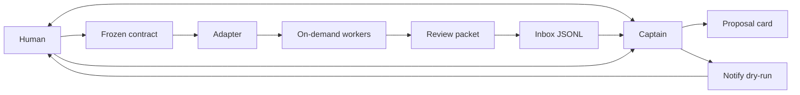

# Architecture


v0.2: [reliability changes and trial](reliability-v0.2.md).

多仓库与 worktree 的执行位置、共享状态、原子派工门禁和状态闭环以
[工作空间接入说明](workspace-parallel.md) 为准。`repo_root` 是执行 checkout，
`base_ref` 是派工时固定的提交，`sequence` 用于同毫秒事件排序；旧事件仍兼容。
CLI 预留名额在 adapter spawn 之前，inbox 的待审/阻塞/审批事件同时更新运行视图。

agent-ship-kit is an acceptance-and-attention layer. A captain agent is the
only thing the human talks to. Workers are created when a contract is frozen
and disappear when their slice is done. An orchestrator, if there is one,
sits behind an adapter. The kit stores events, evidence pointers, and a
notification plan. It does not run models, merge to main, or deploy.

## Captain is a router

The captain talks to the human, routes queued demands to temporary lane owners, compresses decisions, and records routing. Owners coordinate scouts, contract drafts, workers and verifiers. It does not edit product code and it does not run the long task, including work that looks small. It also does not block on a worker: the next human request is accepted while slices run.

Prompt-only delegation is unreliable. A sentence that says "stay the coordinator" sits in the same context that will be asked to implement the next edit, so the boundary dissolves. The frozen contract file is the handoff. Workers execute. The captain returns to the owner.

Follow-up events on a subscribed thread (`thread_refs`: PR, issue, chat) go to the owning worker. The captain handles new or unowned events and coordination across slices.

`worker_progress` in `.agent-ship/events.jsonl` is a heartbeat. `agent-ship watchdog` is a deterministic check, not a model call. It reads that heartbeat, the last commit on the slice's own branch (`slice start --branch`, default `ship/<contract>/<slice>`), and `agent-ship check`. A commit on another branch does not count. It files a `blocked` item (`reason` `stalled` or `drift`) only when one of those is wrong. With no queued or running slice it exits immediately and retains its timer until explicit uninstall. `slice start` registers that timer when the first slice opens: a marked user crontab line on Linux/WSL, or `launchctl bootstrap` of a plist in `~/Library/LaunchAgents` on macOS. Copies under `~/.config/agent-ship/` are not the activation and are never committed. If registration fails, slice start refuses admission unless --allow-untimed explicitly chooses manual supervision; later `watchdog` / `inbox list` runs warn while slices are active and the timer is not. The captain sees only the inbox item.

Inbox summaries are at most 280 characters and carry the recall chain: contract, slice, worker or branch, PR, evidence. `/ship-inbox` shows that card first. The packet is the spill, opened on request.

Notify has two filters. The fast path is the deterministic rule list plus the allowlist. The slow path is the captain reading the policy's prose and optionally passing `--action`, still under the allowlist. A push is at most 100 words, decision-oriented, and includes `/ship-inbox <id>`. The packet stays complete.

Speculative mode is off unless `limits.json` sets `"speculative": true`. The captain may then pre-draft a proposal or a read-only reproduction from an incoming signal, and may show it only when it has evidence. It still does not dispatch or edit code without a frozen contract.

## Captain loop



1. Intake stays in the captain thread. The captain writes a proposal card
   (`skills/ship-contract`).
2. The human freezes a contract. Until that happens there is nothing to spawn.
3. The captain dispatches one worker per slice, through the adapter, without
   exceeding the contract's `max_parallel` or the global cap of 3
   (`skills/ship-dispatch`, `templates/workflow.md`).
4. If the worker is blocked or needs a mid-task decision, it returns that to
   the captain. The captain files `blocked` or `needs_approval`. The human
   does not open the worker session.
5. The worker returns evidence. The captain writes a review packet, including
   E2E rows when smoke ran, and a `needs_review` inbox line (`skills/ship-inbox`,
   `skills/ship-e2e`).
6. Normal inbox items are pull. The notify planner pushes only for a
   high-priority review that has evidence, or for `blocked` / `needs_approval`.
   `notify dry-run` prints the plan. `notify run` may start that argv with no
   shell (`skills/ship-notify`).
7. The human accepts, requests changes, or rejects with `inbox decide`.
   Accepting is not a merge. The human ships with their own tools.

Workers are not a roster. No slice, no worker. The worker's prompt is the
frozen slice, not the captain transcript.

## Events

`events/schema.json` is the envelope. Every event has:

| Field | Required | Notes |
| --- | --- | --- |
| `id` | yes | `evt_` plus letters, digits, `_`, `-` |
| `type` | yes | See below |
| `title` | yes | One line |
| `summary` | yes | What the human needs to know |
| `created_at` | yes | ISO-8601 |
| `source_task_id` | yes | Adapter task id, or the proposal/contract id before dispatch |

Types:

| `type` | When the captain writes it | Extra required fields |
| --- | --- | --- |
| `proposal_ready` | A draft card is ready for the human | — |
| `contract_frozen` | The human froze a contract | — |
| `worker_dispatched` | CLI admitted the frozen slice before adapter spawn | — |
| `needs_review` | A packet is waiting | `evidence_urls`, `priority`, `links` |
| `blocked` | The worker cannot continue | `priority` |
| `needs_approval` | The worker needs a mid-task decision | `priority` |
| `review_decided` | The human decided, closing one inbox item | `decision`, `subject_id` |
| `notify_planned` | A plan was shown | — |

`needs_review`, `blocked`, and `needs_approval` are attention events. The inbox
stores them. `inbox list` shows the ones that do not yet have a
`review_decided` row whose `subject_id` is that item. `inbox list --all`
shows the log, including decisions.

`needs_review` fields:

- `evidence_urls` — array of strings. May be empty only as an explicit draft. `priority: high` with an empty array is not paged. The CLI warns on add and the planner sets `missing_evidence` (or matches no push rule).
- `priority` — `normal` or `high`. Normal items are pull: no push rule in the example policy.
- `links` — object with optional `pr`, `issue`, and `path`. The object is required; each key is optional.

`blocked` and `needs_approval` carry `priority` and the same envelope. They may
push without evidence URLs, because the owner is stuck and does not open the
worker session.

Optional cross-links on any type: `proposal_id`, `contract_id`, `slice_id`, `worker_ref`, `note`. Unknown keys are rejected by the schema (`additionalProperties: false`).

`inbox add --type` writes the three attention types. `inbox decide <id> accept|changes_requested|reject` appends `review_decided`. An event does not authorize a merge or a deploy. `accept` records that the evidence matched the contract, or that the owner answered an escalation.

## Storage

```text
.agent-ship/inbox.jsonl
.agent-ship/hard-rules.json
.agent-ship/proposals/<proposal_id>.md
.agent-ship/contracts/<contract_id>.md
.agent-ship/packets/<task_id>.md
```

The inbox is append-only JSONL, one event per line. `cli/src/inbox.ts` creates
the directory, refuses a duplicate `id`, and refuses a priority other than
`normal` or `high`. Runtime files are gitignored. Templates in `templates/`
are the blanks.

Conventions for ids, branch names, freeze phrases, and the global worker cap: `templates/workflow.md`. Login and smoke tests: `templates/e2e.md` and `templates/e2e-testing.md`.

## Local setup

`agent-ship setup` (alias `init`, captain command `/ship-setup`) prepares one clone. It does not call a forge and it never sets `core.hooksPath`.

Default is local:

- Hooks live only in `.git/hooks`. An existing hook is saved as `pre-commit.agent-ship-chain` or `pre-push.agent-ship-chain` and run after the kit hook. Nothing under `.git/` is committed.
- `.agent-ship/`, `.env*`, and `*.storage-state.json` are written to `.git/info/exclude`, not `.gitignore`.
- The rules block is merged into an untracked `AGENTS.md`, which is then excluded. A tracked `AGENTS.md` is not edited; the block goes to `.agent-ship/AGENTS.local.md`.

`agent-ship setup --shared` is the opt-in that writes a marked block in the shared `.gitignore` and merges the rules into `AGENTS.md` even when that file is already tracked. Hooks stay in `.git/hooks` either way.

`agent-ship setup --uninstall` removes the kit hook (restoring the chained file) and the rules block. `.agent-ship/` stays on disk, and `.git/info/exclude` keeps a marked `.agent-ship/` line so the leftover directory does not show as untracked. `--uninstall --purge` deletes `.agent-ship/` and that line.

`pre-commit` runs `agent-ship check --staged` for `.agent-ship/active-contract` when that file exists, then chains. `pre-push` refuses `main`, `master`, and names in `.agent-ship/protected-branches` unless a human sets `AGENT_SHIP_ALLOW_PROTECTED_PUSH=1`. The captain must not set it.

## Path check

`agent-ship check --root <state> --contract <id> --slice <slice>` reads the shared contract and uses the recorded execution checkout, worker branch and pinned base commit. Unregistered single-repository checks may explicitly pass `--repo`, `--head` and `--base`. Ambiguous multi-repository/branch checks and scopes entering nested Git repositories are rejected. It lists paths with plain `git diff` and prints JSON. A changed path that matches Forbidden paths, or that matches none of the Allowed paths, fails the check. The same command loads `.agent-ship/hard-rules.json` from the state root. A `hook` or `contract_forbidden` glob match fails the check with `rule: "hard_rule"` and that rule's id. `verify_checklist` entries are returned as `checklist` and do not fail the path gate. `--hard-rules` runs only that file, with no contract. `--staged` is what the pre-commit hook uses: the active contract when one is set, otherwise `--hard-rules` when the file exists. The JSON belongs in the review packet's verifier section.

`agent-ship promote` and `inbox decide ... changes_requested --promote hook|contract|verify` write that file. `--promote` defaults to `none`. The file stays under gitignored `.agent-ship/`, so the gate is local to clones that installed the kit. It does not merge, deploy, or add CI for other contributors. Secret-shaped text is refused.

`agent-ship check` fails a new proposal or contract whose `## Human review budget` section is missing `human_reviews_expected` or malformed (the count must match the purpose list), and only warns when that section is absent so older cards still pass; `inbox_needs_review_count` is reported for comparison and the check never merges.

This does not need GitHub, GitLab, or CI. An optional extra, on any host, is to run the same command on the branch. A green extra check does not replace the verifier or the human.

## Verifier

After a worker reports done, its owner arranges a second agent with `templates/verifier-prompt.md`. That agent sees the frozen contract and the branch, not the worker chat. It re-runs acceptance commands, `agent-ship check`, and the relevant E2E smoke. Disagreement goes back to the worker. Agreement is what allows `needs_review`.

`agent-ship eval --fixture <dir>` (sample `cli/test/eval-fixtures/verifier-gates`) is the before/after check when changing `ship-*` skills or these gates; a non-zero exit is a regression.

## Changing a frozen contract

The captain stops slices the change affects, drafts a new contract id with `Supersedes` set to the old id, and waits for the owner to freeze it again. Finished slices the new text does not touch are kept.

## Adapters

```text
spawn(contract_path, slice_id, task_id, prompt) -> task_id, worker_ref
status(task_id) -> queued | running | needs_review | blocked | needs_approval | failed | cancelled
collect(task_id) -> summary, evidence_urls, links
```

`adapters/generic.md` is normative. `adapters/herdr.md`, `adapters/orca.md`,
and `adapters/multica.md` say what to map those calls onto, without vendoring
those products. v0 does not contain their clients and does not invent their
HTTP paths.

`spawn` fails closed when the contract is not `frozen`. None of the three
calls merge or deploy. The example allowlist pattern
`multica issue create --assignee me *` is a notify target, not a `spawn`
implementation; see `adapters/multica.md`.

With no orchestrator, `spawn` is one new agent session per slice. The human
still speaks only to the captain.

## Notify

v0's decision step is a rule parser, not a model call. The policy markdown
can still carry a free-text Instructions section. The parser ignores it and
reads only `## Rule:` blocks. The captain may turn that prose into an argv and
pass `--action`. The allowlist and the empty-evidence refusal still apply.

Pull is the default. The example policy has no push rule for a normal
`needs_review`. Push rules exist for high-priority reviews that have evidence,
and for `blocked` and `needs_approval`.

A rule:

```markdown
## Rule: high priority page

when.priority: high
when.type: needs_review
when.evidence_urls: nonempty
action: curl -X POST https://hooks.example/ship /ship-inbox {id}
note: Page only when evidence exists. Deep link /ship-inbox {id}. Do not merge or deploy.
```

- Conditions: `when.type`, `when.priority`, `when.source_task_id`, and `when.evidence_urls` (`nonempty` or `empty`). An unknown `when.*` key is an error.
- Every `when.` line must match. A rule with no conditions is an error.
- The first matching rule wins. `--action` replaces the matched action with the captain's argv and labels the rule `captain action`.
- `action` is one line of whitespace-separated argv. No quoting. `{id}` is replaced with the event id so the message can name `/ship-inbox <id>`. No other placeholders are expanded.
- If `priority` is `high`, the type is not `blocked` or `needs_approval`, and `evidence_urls` is missing or empty, the plan is `missing_evidence` with `allow: false` even when a looser rule would have matched.

`notify dry-run` prints the plan and does not start a process. `executed` on
that plan is false. Exit 0 means the plan was produced, including a denial.

`notify run` is opt-in. It prints a refusal and exits 1 when `allow` is false.
When `allow` is true it starts that argv from `cli/src/run.ts` with
`shell: false` and no environment expansion, then records the child's exit
code. It does not merge or deploy.

### Allow and deny reasons

| `reason` | What happened |
| --- | --- |
| `allowlisted` | `allow: true`. A pattern matched the full argv. |
| `not_allowlisted` | A rule matched and the argv is ordinary, but no pattern fits. |
| `no_matching_rule` | No rule's conditions matched. This is the pull outcome for a normal review. |
| `missing_evidence` | A high-priority page was selected but `evidence_urls` is empty. `allow` is false and argv is null. |
| `shell_metacharacter` | The action contains a semicolon, ampersand, pipe, backtick, dollar sign, angle bracket, backslash, carriage return, newline, or NUL. Argv is null. |
| `shell_interpreter` | The program is a shell, `eval`, `busybox`, or `sudo` (basename, case-insensitive, optional path prefix). |
| `empty_action` | The action had no tokens. |

### Allowlist patterns

The file is JSON: `{ "patterns": ["multica issue create --assignee me *", "curl -X POST https://hooks.example/* *"] }`. Extra keys such as `version` are ignored. Prefer an exact subcommand over a broad `multica *`. The curl pattern's last `*` is where `/ship-inbox <id>` goes.

Matching rules, implemented by `validatePattern` and `matchPattern`:

- The pattern is split on whitespace.
- The first token is a literal program name matching `[A-Za-z0-9._+/-]+`. It must not contain `*`.
- A token that is exactly `*` matches one argument. If that token is last, it matches one or more remaining arguments. `multica issue create --assignee me` does not match `multica issue create --assignee me *`. `multica issue create --assignee me --title blocked` does. `multica inbox push` does not.
- A token ending in a single `*` with a non-empty prefix matches one argument that starts with that prefix. `https://hooks.example/*` matches `https://hooks.example/ship` and does not match `https://hooks.example.evil/ship`.
- The whole argv must be consumed. An extra argument that the pattern did not account for does not match.
- The loader rejects shell metacharacters in a pattern, a leading `*`, more than one `*` in a token, a `*` that is not a suffix, an empty pattern list, and non-string patterns.
- The loader rejects program names whose basename is a shell, `eval`, `busybox`, or `sudo`.
- The loader rejects a wildcard pattern whose program is `node`, `nodejs`, `deno`, `bun`, `python`, `python3`, `perl`, `ruby`, or `php`.

Denied dry-runs still exit 0: the JSON says `allow: false`. `notify run` on a denied plan exits 1 and does not spawn. Missing files, a broken policy, or a broken allowlist exit 1.

Environment variables are not expanded, so a secret cannot be pulled into the plan by writing `$TOKEN`. The `$` is rejected first.

## Invariants

1. One human and one shared state root have one human-facing captain conversation and N independent owner lanes from intake through ship.
2. Workers are spawned per frozen contract slice. No standing roster is required.
3. The human freezes contracts, reviews packets, and is the one who merges or ships.
4. Notify never starts a shell. `notify run` starts only an allowlisted argv, with `shell: false`, and refuses a high-priority page that has no evidence.
5. No secrets in the repo, the cards, the events, or the policy files.
6. Adapters are replaceable. The event and the contract card are not.
7. One current proposal per owner lane; a new lane never supersedes another lane's proposal or approval. Registered human approval and approved global limits bind every named-lane dispatch and resume.
8. Only the captain executes notifications. Role cards are stable, runtime-free templates; owner/worker instances remain temporary.

The executable v0.2 queue, role and actor contract is specified in [owner-lanes.md](owner-lanes.md). It supersedes single-slot examples below for parallel demands. `active-lane` in each checkout selects `active-contract.<lane>`; the default lane preserves the original unsuffixed files. The host must authenticate actors and connect the generic pre-tool hook; the CLI does not supply an OS isolation boundary.

## What v0 leaves out

- Executable Herdr, Orca, or Multica clients. `notify run` can start an allowlisted `multica issue create ...` argv; it does not implement Multica.
- A Playwright suite inside this repo. `ship-e2e` is the procedure the captain copies into the project under test.
- A model call inside the notify decision step. The markdown is ready for a later captain to read; the CLI does not need one.
- Hosting model runtimes, multi-agent scheduling, auto-merge, and production deploy.
- A persistent cloud runtime, compute/state separation, and device daemons. Those are the orchestrator's job. Adapters map onto them; this kit does not reimplement them.
